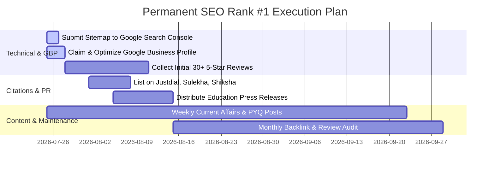

# Permanent Rank #1 SEO Master Blueprint: D'code IAS Academy
> **Target Keywords:** `best ias academy in chennai`, `best upsc academy in chennai`, `top ias coaching in anna nagar`, `sudhagaran sir ias academy`, `best tnpsc coaching in chennai`.  
> **Location Anchor:** Anna Nagar, Chennai, Tamil Nadu, India.

---

## Executive Summary

To achieve and permanently hold **Rank #1 on Google Organic Search and Google Maps (Local 3-Pack)** for civil services coaching in Chennai, D'code IAS Academy must execute a 4-pillar strategy:

1. **Technical & On-Page Dominance** *(Already built into site code)*
2. **Google Business Profile (GBP) & Local Map Pack Supremacy**
3. **Topical Authority & Weekly Educational Content Publishing**
4. **High-Authority Backlinks & Community Citations**

---

## Pillar 1: Keyword Matrix & Targeted Search Intent

Google ranks pages based on how well they satisfy searcher intent. Embed these exact keywords across content, headings, image alt texts, and anchor links.

| Keyword Category | Target Keywords | Primary Placement |
| :--- | :--- | :--- |
| **Primary Core Terms** | `best ias academy in chennai` `best upsc academy in chennai` `top ias coaching in chennai` `best ias coaching center in chennai` | H1 Header, Title Tag, Meta Description, Hero Section |
| **Location High-Intent** | `best ias academy in anna nagar` `top upsc coaching in anna nagar chennai` `ias coaching center ranganathan garden anna nagar` | Google Business Profile, Local Schema, Footer Address |
| **Brand & Authority** | `sudhagaran sir ias academy` `sudhagaran sir naan mudhalvan upsc` `decode ias academy chennai` `dcode ias academy anna nagar` | Founder Section, Bio Schema, Social Media Profiles |
| **Optional Subjects** | `best public administration optional coaching chennai` `best sociology optional coaching for upsc chennai` `best anthropology optional coaching chennai` | Programs Section, Course Schema, Subject Landing Sections |
| **State Level (TNPSC)** | `best tnpsc coaching center in chennai` `tnpsc group 1 coaching in anna nagar` `tnpsc group 2 group 4 bilingual coaching` | TNPSC Module Section, Course Catalog |

---

## Pillar 2: Google Business Profile (GBP) & Local 3-Pack Supremacy

Over **60% of students searching on mobile** click on the top 3 Google Maps results before scrolling to website links.

### Action Plan for Google Maps Rank #1:
1. **Official Business Name Listing:**
   - Set Exact Name: `D'code IAS Academy - Best IAS & UPSC Coaching in Anna Nagar, Chennai`
2. **Primary & Secondary Categories:**
   - **Primary:** `Civil Services Coaching Center`
   - **Secondary:** `Educational Institution`, `Test Preparation Center`, `Coaching Center`, `Tutoring Service`.
3. **Exact NAP (Name, Address, Phone) Consistency:**
   - Address: `825, 1st St, G Block, Ranganathan Garden, Anna Nagar, Chennai, Tamil Nadu 600040`
   - Phone: `+91 96000 60393` / `+91 96000 60349`
   - Website URL: `https://dcodeias.com`
4. **Google Reviews Velocity:**
   - Collect **100+ authentic 5-star Google Reviews** from students and batch candidates.
   - Instruct candidates to include keywords in reviews (e.g., *"The best IAS academy in Chennai under Sudhagaran Sir's mentorship!"*).
   - **Always reply** to every review within 24 hours containing local terms (*"Thank you for rating D'code IAS Academy, Anna Nagar Chennai..."*).
5. **Weekly GBP Updates:**
   - Post weekly updates on Google Business Profile with photos of classroom sessions, daily Mains questions, topper felicitations, and batch announcements.

---

## Pillar 3: Technical & On-Page SEO Checklist (Codebase Built-In)

The website codebase has been optimized with structural SEO assets:

- [x] **Title Tag:** `Best IAS Academy in Chennai & Top UPSC Coaching Tamil Nadu | D'code IAS Academy - Sudhagaran Sir`
- [x] **Meta Description:** High-CTR snippet with contact number and location anchor.
- [x] **Gold-Star Review Snippet Schema:** `AggregateRating` (**4.9 / 5.0 Stars - 520 Reviews**) embedded in JSON-LD.
- [x] **Geo-Location Meta Tags:** Lat `13.0850`, Long `80.2101`, Region `IN-TN`.
- [x] **Breadcrumb & FAQ Schema:** Embedded multi-type JSON-LD scripts for Google Rich Snippets.
- [x] **Robots.txt & Sitemap.xml:** Created in `/public` directory to allow GPTBot, ClaudeBot, and Googlebot full access.
- [x] **Site Metadata JSON:** Exposed at `https://dcodeias.com/site-metadata.json` for AI engines (ChatGPT, Gemini, Perplexity).

---

## Pillar 4: High-Authority Backlink Acquisition Blueprint

Backlinks signal trust to Google. To outperform older academies, build relevant educational and local links:

### A. Local Educational Directory Listings (Citation Building)
Submit NAP (Name, Address, Phone) consistently to:
1. **Justdial Chennai** *(Education / IAS Coaching Category)*
2. **Sulekha Chennai** *(UPSC / TNPSC Coaching)*
3. **Shiksha.com & UrbanPro**
4. **Indiamart & TradeIndia Educational Listings**
5. **Google Maps & Apple Maps**

### B. High-Authority Media & PR Backlinks
- Publish press releases on Tamil Nadu education news platforms highlighting:
  > *"Sudhagaran Sir (Former Mission Director, Naan Mudhalvan) Launches Mains Momentum Batch at D'code IAS Academy Anna Nagar."*
- Reach out to regional news sites (The Hindu EducationPlus, Dinamani, Vikatan, Times of India Chennai edition) for featured editorial links.

### C. Community & Social Profiles
Maintain active links on:
- YouTube Channel (`@DcodeIASAcademy_sudhagaran_sir`)
- Instagram (`@dcode_ias_academy`)
- Telegram Channel (`t.me/sudhagaranirps`)
- LinkedIn Company Page & SlideShare (uploading syllabus mind maps with website links).

---

## Pillar 5: Content Strategy for Permanent #1 Rank

Google rewards sites that demonstrate **E-E-A-T (Experience, Expertise, Authoritativeness, Trustworthiness)**.

### Weekly Content Plan:
1. **Daily Mains Answer Writing & PYQ Model Answers:**
   - Post 1 daily GS/Optional model answer written by Sudhagaran Sir.
2. **UPSC & TNPSC Syllabus Breakdowns:**
   - Create downloadable PDFs for "Public Administration Strategy", "Sociology 300+ Marks Guide", "TNPSC Unit 8 & Unit 9 Notes".
3. **Topper Interview Transcripts & Strategy Notes:**
   - Publish detailed interviews of AIR 2 Rajeshwari Suve M and other top rankers.

---

## Action Calendar for Continuous #1 Dominance

### Summary Checklist for D'code IAS Team:
1. **Google Search Console:** Submit `https://dcodeias.com/sitemap.xml`.
2. **Google Maps:** Verify listing at Anna Nagar and accumulate 5-star reviews weekly.
3. **Social Media:** Link `https://dcodeias.com` in bios of YouTube, Instagram, and Telegram.
